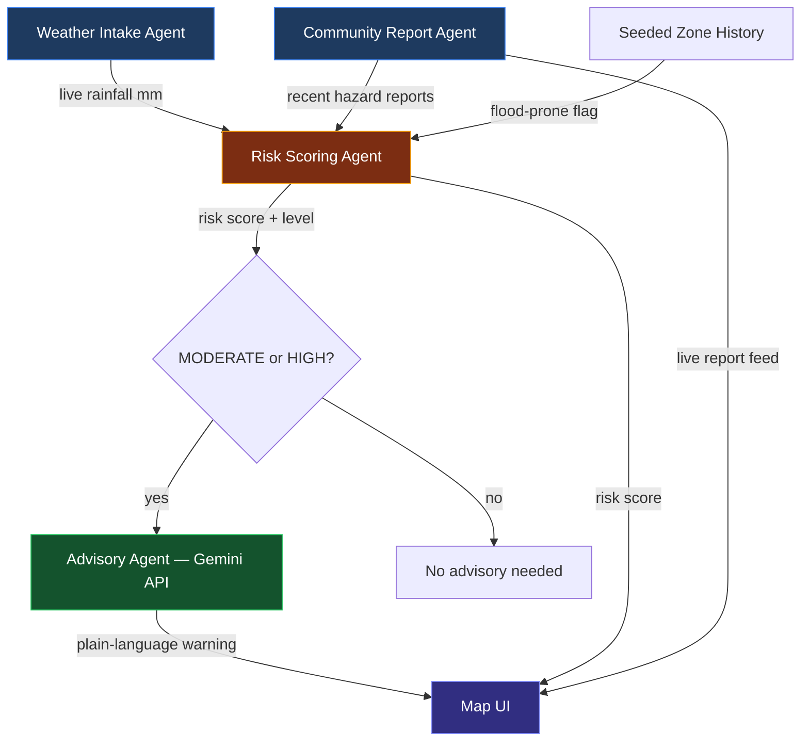

# 🌧️ syed-i-love-you (Delhi Hazard Watch & Urban Flood Nowcasting System)

A multi-agent flood risk advisory tool for Karachi, built for **Google Gen AI Academy APAC — Meet the Builders**.

Combines live rainfall data, curated historical flood-zone knowledge, real community hazard reports, and Gemini-generated plain-language safety advisories into a single live risk map.

## The problem

Every monsoon, the same Karachi underpasses and low-lying areas flood — Saddar, Korangi, North Karachi, Liaquatabad. Standard navigation apps show traffic congestion, not flood risk or road-hazard conditions, so commuters get routed into unsafe areas with no warning.

## Architecture — agent pipeline



| Agent | File | What it does |
|---|---|---|
| **Weather Intake Agent** | `weather_agent.py` → `fetch_rainfall_mm()` | Pulls live 3-hour rainfall forecast from OpenWeatherMap per zone. Degrades gracefully to 0mm if the API is unreachable — never crashes the pipeline. |
| **Community Report Agent** | `main.py` → `/api/reports` | Real submit + read endpoints backed by local SQLite. Citizens report waterlogging, broken roads, open manholes, power outages, blocked roads. |
| **Risk Scoring Agent** | `weather_agent.py` → `score_risk()` | Combines live rainfall + historical flood-proneness + recent report count into an explainable 0–10 score (NONE / LOW / MODERATE / HIGH). |
| **Advisory Agent** | `advisory_agent.py` → `get_advisory()` | Calls Gemini API to generate a plain-language safety warning — **only for MODERATE/HIGH risk zones, only on user click** (never on the 30s auto-refresh), and cached per zone/risk-level to stay within free-tier quota. |

## Setup

```bash
pip install -r requirements.txt
python seed_data.py
```

Two free API keys, both optional (the app runs and degrades gracefully without them):

```bash
# Windows PowerShell
$env:OPENWEATHER_API_KEY="your_key_here"   # https://openweathermap.org/api
$env:GEMINI_API_KEY="your_key_here"        # https://aistudio.google.com/apikey

# macOS/Linux
export OPENWEATHER_API_KEY=your_key_here
export GEMINI_API_KEY=your_key_here
```

```bash
uvicorn main:app --reload
```

Then open **http://127.0.0.1:8000**

## What's real vs seeded — stated upfront

- **Real, live:** rainfall data (OpenWeatherMap), risk score calculation, community report submission/storage, Gemini-generated advisories.
- **Seeded/curated:** the 6 Karachi zones and their flood-prone history are manually curated from public knowledge of underpasses and low-lying areas that flood every monsoon — no live municipal flood-data feed exists publicly for Karachi. 5 sample reports are pre-seeded so the map isn't empty on first load.

This is a proof-of-concept built in days, not a production system — documented honestly rather than overstated.

## Tech stack

Python · FastAPI · SQLite · OpenWeatherMap API · Gemini API (`google-genai`) · Leaflet + OpenStreetMap

## Built for

Google Gen AI Academy APAC — Meet the Builders campaign.
